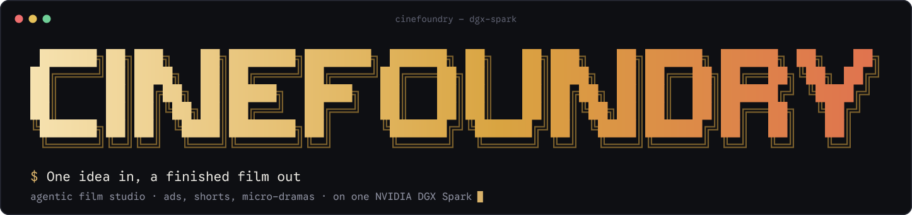
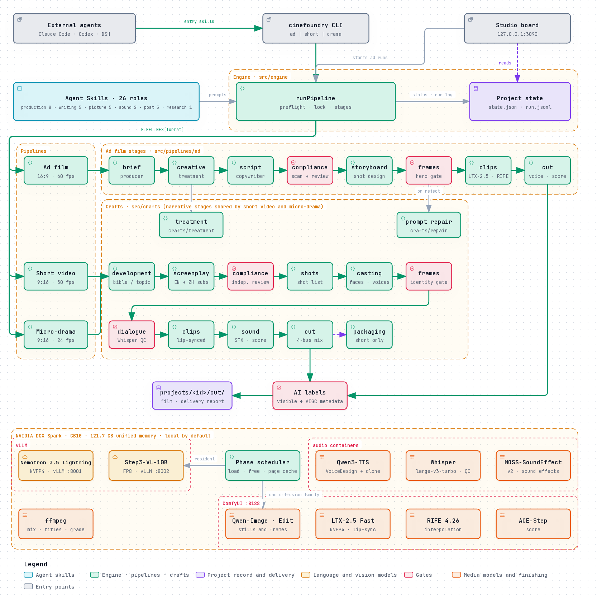

<p align="center">
  
</p>

<p align="center">
  <b>English</b> · <a href="README.zh-CN.md">简体中文</a>
</p>

<p align="center">
  <a href="LICENSE"></a>
  
  
  
  
</p>

<p align="center">
  <a href="#why-cinefoundry">Why Cinefoundry</a> ·
  <a href="#how-it-works">How it works</a> ·
  <a href="#quick-start">Quick start</a> ·
  <a href="#formats-and-specs">Formats</a> ·
  <a href="#quality-system">Quality</a> ·
  <a href="#agent-skills">Agent Skills</a> ·
  <a href="#tech-stack-and-deployment">Tech stack</a> ·
  <a href="#license-and-commercial-use">License</a>
</p>

**Cinefoundry is an agentic film studio that runs on a single NVIDIA DGX Spark. One idea in, a finished film out.**

A crew of AI agents — creative director, screenwriter, director of photography, casting, voice director, sound designer, editor, compliance reviewer and QC — takes a single sentence to a delivered film: picture, performance, dialogue, sound design, score, bilingual subtitles and AI labels, every frame checked before the next stage starts. Every model runs on the machine; no footage, script or product photo leaves it.

| Format | What you get |
|---|---|
| **Ad film** | A 30-second master with 15- and 6-second cutdowns, English announcer, Chinese-over-English subtitles, compliance-checked copy. 16:9, native 1080p, 60 fps. |
| **Short video** | Presenter pieces, reviews, explainers and skits for Douyin, Bilibili and YouTube Shorts, with a three-second hook and the packaging the feed needs: three titles to test, cover, description, hashtags. |
| **Micro-drama** | A vertical series: series bible, a cast with locked faces and designed voices, lip-synced English dialogue, sound design and score, delivered episode by episode. |

## Why Cinefoundry

| | Traditional production | General AI video tools | Cinefoundry |
|---|---|---|---|
| **Who does the work** | A crew of specialists over weeks | One person prompting clip by clip | A crew of 26 role agents, each working under the craft standard of its role |
| **Consistency** | Real product, real actors | The product and the faces drift from shot to shot | One gated hero still per product, one locked reference portrait per character; every frame is generated from it |
| **Quality control** | Producers, editors, QC houses | Whoever watches the output | A vision gate on every frame, Whisper on every spoken line, an independent compliance reviewer on every word, before the next, more expensive stage |
| **On-screen text** | Typeset in post | The model paints it, often garbled | The model never draws text; titles and subtitles are typeset in a real font checked for every glyph |
| **Compliance** | Agency legal review | None | Advertising Law wording scan, broadcast rules for micro-dramas, explicit and implicit AI labels (GB 45438-2025) on every deliverable |
| **Data** | On set | Uploaded to a cloud API | Never leaves the machine; cloud routes exist only when you switch them on, and are labelled `cloud` |
| **Record** | Production reports | None | Every model call, gate verdict and measured time in `run.jsonl`; a delivery report lists every open item |

## How it works

<p align="center">
  
</p>

- **One engine, many formats.** The Cinefoundry Engine (`src/engine`) owns what every production needs: preflight, the one-film-at-a-time lock, stage status on the studio board, the run log, agent prompts, model scheduling and failure handling. A format is a pipeline (`src/pipelines/ad`, `short`, `drama`): an ordered list of stages, each run by an agent under its skills.
- **Code owns the order and the acceptance checks; models own the judgement.** Every agent's output passes deterministic validators before the next stage; a rejected draft goes back with the exact reasons. The same validators score the with/without-skill evaluation.
- **Shared crafts.** Writing, picture, sound and post (`src/crafts`) are shared between formats: the ad's creative treatment, the narrative screenplay, casting, identity-gated frames, lip-synced dialogue, the four-bus mix and bilingual subtitles.
- **Gates between stages.** Copy and dialogue that fail compliance never reach generation; a frame that fails the vision gate is regenerated before any video time is spent; a line Whisper mishears is retaken.
- **One memory pool, scheduled.** CPU and GPU share 121.7 GB of unified memory. Both language models stay resident; diffusion models are loaded per phase and released at every phase boundary, so one diffusion family is resident at a time.
- **Skills are an open format.** All 26 skills drive the `cinefoundry` CLI through files and JSON, so Claude Code, Codex, DeepSeek Harness or any client that loads Agent Skills can run the studio.

## Quick start

```bash
git clone https://github.com/hojiahao/cinefoundry.git && cd cinefoundry
scripts/install.sh            # checks the machine, installs, downloads and verifies every weight (sha256), builds the voice library, starts the stack
```

`scripts/install.sh --check` reports what is missing without changing anything; every option is in [docs/install.md](docs/install.md).

One command per format:

```bash
node dist/cli.js ad    "A 30-second film for Misthaven, a woody fragrance in a heavy faceted glass bottle, for women around thirty"
node dist/cli.js short "A 60-second skit in a specialty coffee bar: a barista talks a regular into trying a natural-process Ethiopian"
node dist/cli.js drama "A fake-dating romance: to save her late grandmother's perfume shop, a young perfumer signs a three-month contract with the heir buying up the street" --episodes 3 --produce 1
```

Add `--plan-only` to approve the script, screenplay or shot list before any GPU time is spent. `node dist/cli.js studio` opens the studio board at `http://127.0.0.1:3090`: the live log, every stage, every frame and clip with where and how fast it was made, the finished film and its delivery report.

No GPU needed for the compliance scanner:

```bash
echo "全网第一的香水，100%纯天然" | node dist/cli.js copy-check - --category cosmetics
```

## Formats and specs

| | Ad film | Short video | Micro-drama |
|---|---|---|---|
| Command | `cinefoundry ad` | `cinefoundry short` | `cinefoundry drama` |
| Frame | 16:9 (9:16, 1:1 on request) | 9:16 (16:9 for Bilibili, YouTube) | 9:16 |
| Resolution | Native 1080p; 2K, 4K, 6K delivery presets (upscaled, and reported as such) | Native 1080p | Native 1080p |
| Frame rate | 60 fps, interpolated from 24 with RIFE | 30 fps (60 for product and motion) | 24 fps, the film look |
| Length | 30 s master, 15 s and 6 s cutdowns | 60 s by default, up to 3 min | 2-minute episodes, a series plan of any length |
| Voice | English announcer cast from the voice library | Presenter or characters, lip-synced English | Characters, lip-synced English |
| Subtitles | Chinese over English | Chinese over English, inside the vertical safe zone | Chinese over English, inside the vertical safe zone |
| Loudness | −16 LUFS, −1.5 dBTP | −14 LUFS | −14 LUFS |
| AI labels | Explicit label on the opening and the end card, implicit AIGC metadata | Same, plus the disclosure in the description | Same, on every episode |
| Revisions | `cinefoundry revise`: redo a shot, change a line, regrade or rescore; only the master and the cutdowns that depend on it are re-made | Same; the episode is re-cut, a changed line re-voiced and re-lip-synced | Same, per episode |
| Interchange | `cinefoundry export`: EDL, FCPXML (and FCP 7 XML), OpenTimelineIO, four stems, SRT | Same | Same, per episode |

Subtitles follow the Netflix timed-text style guide per language: at most 16 Chinese characters a line on 16:9 and 12 on 9:16, spaces instead of commas and full stops, English under it at 60 % of the size, each line on screen while it is spoken.

Revisions take the run lock, refuse a line that fails compliance before touching anything, keep every replaced file under a versioned name and are recorded in the run log and the delivery report: see [docs/revisions.md](docs/revisions.md).

## Quality system

- **Vision gate on every frame.** Step3-VL compares each first frame with the approved reference — the product's hero still in an ad, each character's locked portrait in a story — and rejects a different product or face, stray or garbled text, malformed hands, a CGI look, or light and composition below the craft floor. Rejected frames are regenerated with new seeds, then with prompts repaired against the gate's own words.
- **Every spoken line checked by ear.** Whisper large-v3-turbo transcribes each take; English is scored by word, Chinese by toned syllable, and a line above the threshold is retaken. A line no retake fixes is listed as an open item, never passed silently.
- **Compliance before generation.** A deterministic scan for Advertising Law wording in both languages, then an independent reviewer on another model who did not write the copy. Micro-dramas and shorts are reviewed against the NRTA micro-drama rules, the 2026 content clean-up categories, AI labelling and likeness rights. Characters are adults; faces and voices are designed, never a real person's.
- **Delivery labels.** The explicit "AI-generated" label opens every film and closes it on the end card at 5 % of the frame's short side, clear of the player's own UI; the implicit AIGC metadata follows GB 45438-2025.

**Skills measurably improve the agents.** The same Nemotron, the same eight briefs, two runs each; the only variable is whether the stage agent loads its skill. Each stage gets one attempt and the engine's validators ([`src/agent/checks.ts`](src/agent/checks.ts)) count violations:

| | Without skill (Sep 21) | With skill (Sep 21) | Without skill (Sep 22) | With skill (Sep 22) | Without skill (Sep 23) | With skill (Sep 23) |
|---|---:|---:|---:|---:|---:|---:|
| Script passes first time | 0/16 | 6/16 | 13/16 | 15/16 | 11/16 | 14/16 |
| Script violations (mean) | 3.63 | 1.06 | 0.38 | 0.06 | 0.38 | 0.13 |
| Storyboard passes first time | 0/16 | 8/14 | 0/16 | 7/15 | 0/15 | 6/15 |
| Storyboard violations (mean) | 8.00 | 0.71 | 3.88 | 0.80 | 3.80 | 0.80 |

From September 22 the hard limits (beat count, line length, shot count) moved into the stage prompts, which lifted the baseline: rules that can be written down belong in the prompt, judgement belongs in the skill. The storyboard gap stays wide. Reports: [script](.agents/skills/ad-script-writing/BENCHMARK.md) · [storyboard](.agents/skills/storyboard-design/BENCHMARK.md) · raw data [1](eval/results/ablation.json) · [2](eval/results/ablation-v2.json) · [3](eval/results/ablation-v3.json). Reproduce with `cinefoundry eval --repeats 2`.

## Agent Skills

26 skills, one per real production role, in six categories. The three formats share the picture, sound and post crews; writing and compliance are specialised per format.

**Production**

| Skill | Role | What it does |
|---|---|---|
| [`cinefoundry-ad-film`](.agents/skills/cinefoundry-ad-film/SKILL.md) | Ad producer | Entry point for external agents: one brief to a finished ad, reported from the delivery record |
| [`cinefoundry-short-video`](.agents/skills/cinefoundry-short-video/SKILL.md) | Short-video producer | Entry point: topic to finished short and its packaging |
| [`cinefoundry-micro-drama`](.agents/skills/cinefoundry-micro-drama/SKILL.md) | Series producer | Entry point: series bible, casting and episodes |
| [`ad-brief-intake`](.agents/skills/ad-brief-intake/SKILL.md) | Account planner | Reads the brief, asks only what blocks it, decides the rest |
| [`brand-kit`](.agents/skills/brand-kit/SKILL.md) | Brand guardian | A reusable brand kit - lettering, logo, palette, fonts, voice, tone, claims, legal lines - applied to every film made under it |
| [`ad-compliance-review`](.agents/skills/ad-compliance-review/SKILL.md) | Advertising legal | Advertising Law wording scan and an independent reviewer; `block` findings must be rewritten |
| [`content-compliance`](.agents/skills/content-compliance/SKILL.md) | Content review | Micro-drama regulation, content red lines, AI labelling, platform disclosure, likeness and voice rights |
| [`spark-model-scheduler`](.agents/skills/spark-model-scheduler/SKILL.md) | Technical producer | Measures unified memory, then loads and releases models phase by phase |

**Writing**

| Skill | Role | What it does |
|---|---|---|
| [`creative-direction`](.agents/skills/creative-direction/SKILL.md) | Creative director | Insight, proposition, concept and the director's treatment every later stage works from |
| [`ad-script-writing`](.agents/skills/ad-script-writing/SKILL.md) | Copywriter | Top-agency broadcast copy: beats, announcer lines, titles, category register |
| [`series-development`](.agents/skills/series-development/SKILL.md) | Showrunner | Series bible: logline, world, characters, per-episode hooks and cliffhangers, paywall placement |
| [`screenwriting`](.agents/skills/screenwriting/SKILL.md) | Screenwriter | Scenes, action and subtext; American-TV English dialogue with natural Chinese subtitles |
| [`short-video-scripting`](.agents/skills/short-video-scripting/SKILL.md) | Creator-content writer | The three-second hook, retention structure, presenter, review, explainer and skit formats |

**Picture**

| Skill | Role | What it does |
|---|---|---|
| [`storyboard-design`](.agents/skills/storyboard-design/SKILL.md) | Director, storyboard | Shot design and rhythm: six shots of a 30-second master, each with its job |
| [`cinematography-and-art-direction`](.agents/skills/cinematography-and-art-direction/SKILL.md) | DP, production design | Lens language, one light logic, sets and props, product styling, casting and performance |
| [`character-and-continuity`](.agents/skills/character-and-continuity/SKILL.md) | Casting, wardrobe, script supervisor | Locked reference portraits, wardrobe and prop continuity, screen direction, the same face across shots and episodes |
| [`spark-local-media-generation`](.agents/skills/spark-local-media-generation/SKILL.md) | Camera crew | Hero still, reference-anchored first frames, first-frame-driven video at native 1080p, RIFE interpolation |
| [`shot-quality-gate`](.agents/skills/shot-quality-gate/SKILL.md) | Video assist, QC | Every frame against its reference: wrong subject, stray text, garbled lettering or a CGI look is rejected |

**Sound**

| Skill | Role | What it does |
|---|---|---|
| [`dialogue-and-voice`](.agents/skills/dialogue-and-voice/SKILL.md) | Voice director, dialogue | Casts each character's designed voice, directs delivery, checks every line with Whisper, sets lip-sync shot rules |
| [`sound-design-and-music`](.agents/skills/sound-design-and-music/SKILL.md) | Sound designer, composer | Effects per shot, ambience per scene, score direction, all generated locally |

**Post**

| Skill | Role | What it does |
|---|---|---|
| [`editing-and-versioning`](.agents/skills/editing-and-versioning/SKILL.md) | Editor | Rhythm and story, cutting on action, retention editing for shorts, 30/15/6-second versions, episode endings |
| [`final-cut-assembly`](.agents/skills/final-cut-assembly/SKILL.md) | Finishing | End card, typeset titles and subtitles, grade, voice and score mix |
| [`bilingual-subtitles`](.agents/skills/bilingual-subtitles/SKILL.md) | Subtitles | Chinese over English: line length, reading speed, timing and safe areas |
| [`platform-packaging`](.agents/skills/platform-packaging/SKILL.md) | Packaging | Three titles to test, cover, description, hashtags, AI disclosure |
| [`delivery-qc`](.agents/skills/delivery-qc/SKILL.md) | QC and delivery | Duration, frame rate, bitrate, loudness and true peak, black frames and silence, subtitle overflow, AI labels |

**Research**

| Skill | Role | What it does |
|---|---|---|
| [`ad-reference-breakdown`](.agents/skills/ad-reference-breakdown/SKILL.md) | Reference research | Cuts a reference film into shots, describes each, maps it to the new product |

## Tech stack and deployment

| Layer | Components |
|---|---|
| Platform | NVIDIA DGX Spark: GB10 Grace Blackwell, aarch64, 121.7 GB unified memory; Docker with the NVIDIA Container Toolkit (CDI) |
| Language | `nvidia/NVIDIA-Nemotron-3.5-Lightning-30B-A3B-NVFP4` with its DGX Spark speculative-decoding draft (vLLM): planning, writing, review, shot design, English media prompts |
| Vision | `stepfun-ai/Step3-VL-10B-FP8` (vLLM): the quality gate and reference-film breakdown |
| Image | Qwen-Image and Qwen-Image-Edit with Lightning LoRAs (ComfyUI): hero stills, reference portraits, reference-anchored frames |
| Video | LTX-2.5 Fast NVFP4 (ComfyUI), native 1080p, including audio-driven lip-sync against a frozen dialogue track; Wan2.2 I2V A14B as an alternative; RIFE 4.26 interpolation |
| Voice | Qwen3-TTS 1.7B VoiceDesign and Base: a casting library of 52 designed voices — English and Mandarin, female and male, five adult age bands — each kept only if Whisper, pitch and level checks pass |
| Speech check | Whisper large-v3-turbo |
| Sound and music | MOSS-SoundEffect v2 (48 kHz effects and ambience), ACE-Step (score) |
| Finishing | ffmpeg and libass: grade, typeset titles and subtitles, four-bus mix, loudness, AIGC metadata |
| Engine | TypeScript on Node.js 22, no runtime dependencies; Vitest |

**Deploy.** `scripts/spark-up.sh` refuses to start without enough free unified memory, brings up Nemotron (:8001), Step3-VL (:8002) and ComfyUI (:8188), then runs `cinefoundry doctor`, which checks every workflow template node by node against the running ComfyUI. Ports are configurable with `CINEFOUNDRY_PLANNER_URL`, `CINEFOUNDRY_VISION_URL` and `COMFYUI_URL`; the services are configured in [`deploy/spark/compose.yaml`](deploy/spark/compose.yaml), and every environment variable Cinefoundry reads, with its default, is listed in [`docs/configuration.md`](docs/configuration.md). The voice and sound containers are built from `deploy/spark/qwen-tts` and `deploy/spark/moss-audio`; `scripts/voice-design.py` and `scripts/voice-qc.py` build the voice library from [`deploy/voices/library.json`](deploy/voices/library.json).

**Optimisation.**

| Technique | How | Why |
|---|---|---|
| NVFP4 | Nemotron 3.5 Lightning 30B-A3B in NVIDIA's NVFP4 weights (21.6 GB); LTX-2.5 Fast in NVFP4 | GB10 decoding is bandwidth-bound: smaller weights decode faster |
| Speculative decoding | The official DGX Spark draft weights, three speculative tokens | Lossless speed-up tuned for single-stream use |
| FP8 KV cache, prefix caching | `--kv-cache-dtype fp8 --enable-prefix-caching` | Every agent call repeats the same system prompt and skill |
| Thinking only where it pays | Writing and review run with reasoning off; reasoning is used on the last attempts of a rejected draft | Reasoning on every call spent the whole token budget and returned nothing |
| Phase scheduling | ComfyUI releases each diffusion family at a phase boundary (hero still, frames, clips, interpolation, music) | Two diffusion families resident at once made GPU allocation fail |
| Queued frames | Every shot's gate loop runs at once; ComfyUI renders while the reviewer judges | The image model is never idle waiting for a verdict |

**Measured on the machine** (single request):

| | Measured |
|---|---|
| Nemotron 3.5 Lightning decode, with speculative decoding | 98–106 tok/s |
| Unified memory free with both language models resident | 47.6 GB |
| Product hero still (Qwen-Image, 8 steps) | about 42 s, 66 s with its gate |
| Reference-anchored first frame (Qwen-Image-Edit) | 60–75 s |
| LTX-2.5 Fast NVFP4, one 5-second clip at native 1080p | 247 s |
| LTX-2.5 Fast NVFP4, one 5-second lip-synced dialogue shot at native 1080p | 238 s |
| RIFE 4.26, one clip to a 120 fps master | 49 s |
| MOSS-SoundEffect v2, one 10-second ambience bed | 41 s, 16 GB peak |

**Local by default.** With `ARK_API_KEY` set, `--video-model seedance` sends video generation to Volcano Engine Seedance; with `STEPFUN_API_KEY`, text review can use Step-3.7-Flash; with `TYPESAFE_API_KEY`, the Jev judge scores copy. Every cloud asset is recorded as `cloud`. The repository contains no keys.

## License and commercial use

Cinefoundry is developed and owned by 贺家豪 (Jiahao He) and released under the [Business Source License 1.1](LICENSE): the source is available for learning, evaluation, and non-commercial personal and academic projects. Producing advertising or other video content for a business or organisation, or offering Cinefoundry or a derivative as a product or service, requires a commercial license from the author. Each version converts to Apache-2.0 four years after its first release (at the latest on 2030-10-17). Versions released on or before 2026-10-13 (commit 36bf724 and earlier) remain under the MIT license.

**Commercial licensing:** open an issue or contact the author on GitHub ([@hojiahao](https://github.com/hojiahao)).

The models Cinefoundry runs keep their own licenses (LTX-2.5 under the LTX-2.x community license). Brands in the sample films are fictional; voices are designed from written descriptions and belong to no real person. Content made with Cinefoundry and published must carry the platform's AI-generated label.

## Author

Built by 贺家豪 (Jiahao He). Excellence Award, Agent Skills Challenge, 3rd NVIDIA DGX Spark Hackathon. Essay: [*Ten Days: making ad films on one DGX Spark*](https://zhuanlan.zhihu.com/p/2088218312492828625) (Chinese).
