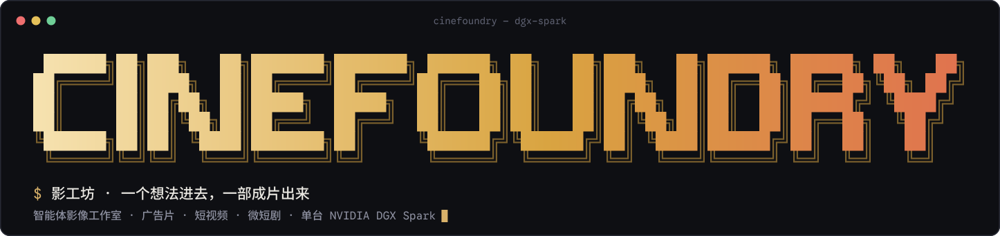
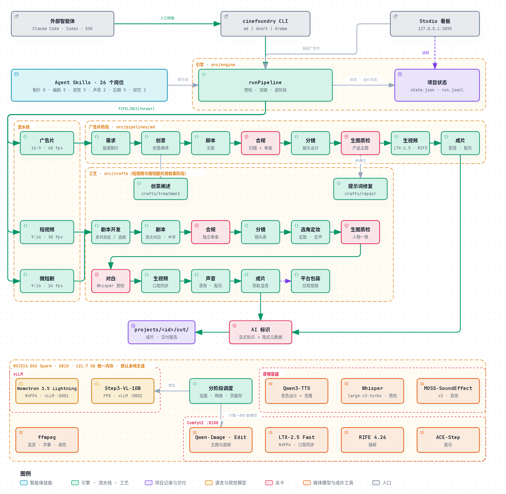

<p align="center">
  
</p>

<p align="center">
  <a href="README.md">English</a> · <b>简体中文</b>
</p>

<p align="center">
  <a href="LICENSE"></a>
  
  
  
  
</p>

<p align="center">
  <a href="#为什么是影工坊">为什么是影工坊</a> ·
  <a href="#工作原理">工作原理</a> ·
  <a href="#快速开始">快速开始</a> ·
  <a href="#片型与规格">片型与规格</a> ·
  <a href="#质量体系">质量体系</a> ·
  <a href="#agent-skills">Agent Skills</a> ·
  <a href="#技术栈与部署">技术栈</a> ·
  <a href="#许可与商业授权">许可</a>
</p>

**Cinefoundry（影工坊）是运行在单台 NVIDIA DGX Spark 上的智能体影像工作室。一个想法进去，一部成片出来。**

创意总监、编剧、摄影指导、选角、配音导演、声音设计、剪辑、合规审查、技术质检，一组 AI 智能体把一句话做成一部交付级成片：画面、表演、对白、音效、配乐、中英双语字幕与 AI 标识一应俱全，每一帧都先过质检才进入下一个环节。所有模型都在这台机器上运行，素材、剧本、产品照片不出本机。

| 片型 | 交付什么 |
|---|---|
| **广告片** | 30 秒主片与 15 秒、6 秒剪辑版：英文旁白、中文在上英文在下的双语字幕、过审的文案。16:9，原生 1080p，60 fps。 |
| **短视频** | 面向抖音、B 站、YouTube Shorts 的口播、测评、知识与剧情短片：前三秒钩子，外加信息流需要的包装——三套待测标题、封面、简介、话题标签。 |
| **微短剧** | 竖屏连续剧：剧集圣经、定妆锁脸的角色与专属声线、口型同步的英文对白、音效与配乐，逐集成片。 |

## 为什么是影工坊

| | 传统制作 | 通用 AI 视频工具 | 影工坊 |
|---|---|---|---|
| **谁来做** | 一组专业人员，按周计 | 一个人逐段写提示词 | 25 个岗位智能体，各按本岗位的行业规范工作 |
| **一致性** | 真实产品、真实演员 | 产品和人脸在镜头之间变样 | 每个产品一张过审的定妆图，每个角色一张锁定的定妆照，每一帧都以它为参考生成 |
| **质量把关** | 制片、剪辑、质检公司 | 谁看谁把关 | 每一帧过视觉质检，每一句台词过 Whisper 校音，每一个字过独立审稿，都在进入下一个更贵的环节之前 |
| **画面文字** | 后期排版 | 模型直接画，常出乱码 | 模型从不画字；标题和字幕用真字体排版，排版前逐字检查字体覆盖 |
| **合规** | 代理商法务审核 | 无 | 《广告法》用词扫描、微短剧管理规定、每件成片都带显式与隐式 AI 标识（GB 45438-2025） |
| **数据** | 留在片场 | 上传云端 API | 不出本机；云端通道只在你主动开启时使用，并标注为 `cloud` |
| **记录** | 制片报告 | 无 | 每次模型调用、每个质检结论、每段实测耗时都写入 `run.jsonl`；交付报告列出每一项遗留问题 |

## 工作原理

<p align="center">
  
</p>

- **一个引擎，多种片型。** 影工坊引擎（`src/engine`）负责每一部片都需要的事：启动前检查、一次只拍一部的运行锁、工作台上的阶段状态、运行记录、智能体提示词、模型调度与失败处理。每种片型是一条流水线（`src/pipelines/ad`、`short`、`drama`）：一串有序的阶段，每个阶段交给加载了对应 Skill 的智能体。
- **顺序和验收归代码，判断归模型。** 每个智能体的产出都先过确定性校验，不合格就带着具体问题退回重写。同一套校验器也用于“带 / 不带 Skill”的对比评测。
- **工艺共享。** 编剧、视觉、声音与后期工艺（`src/crafts`）在片型之间共用：广告的导演阐述、叙事类剧本、选角、按身份质检的生图、口型同步对白、四轨混音与双语字幕。
- **阶段之间有质检门。** 没过合规的文案和台词到不了生成环节；没过视觉质检的画面在花视频时间之前就重拍；Whisper 听错的台词重录。
- **一个内存池统一调度。** CPU 与 GPU 共用 121.7 GB 统一内存。两个语言模型常驻；扩散模型按阶段加载，在每个阶段切换时释放，同一时间只留一族。
- **Skill 是开放格式。** 25 个 Skill 都通过文件和 JSON 驱动 `cinefoundry` 命令行，Claude Code、Codex、DeepSeek Harness 等任何支持 Agent Skills 的客户端都能直接驱动这个工作室。

## 快速开始

```bash
git clone https://github.com/hojiahao/cinefoundry.git && cd cinefoundry
npm install && npm run build && npm test

HF_ENDPOINT=https://hf-mirror.com scripts/download-models.sh   # 下载权重，可断点续传
scripts/spark-up.sh                                            # 启动 Nemotron、Step3-VL、ComfyUI 并自检
```

每种片型一条命令：

```bash
node dist/cli.js ad    "给木质调香水“雾岸”做一条 30 秒广告：厚重的切面玻璃瓶，面向三十岁左右的都市女性"
node dist/cli.js short "精品咖啡馆里的 60 秒剧情短片：咖啡师说服一位常客尝试日晒埃塞俄比亚豆"
node dist/cli.js drama "契约恋人：为了保住外婆留下的香水店，年轻调香师和要收购整条街的继承人签下三个月的假恋爱协议" --episodes 3 --produce 1
```

加 `--plan-only` 可以先审脚本、剧本或分镜，再花 GPU 时间。`node dist/cli.js studio` 在 `http://127.0.0.1:3090` 打开工作台：实时日志、每个阶段、每一帧与每个片段的生成位置和耗时、成片与交付报告。

不需要 GPU 的合规扫描：

```bash
echo "全网第一的香水，100%纯天然" | node dist/cli.js copy-check - --category cosmetics
```

## 片型与规格

| | 广告片 | 短视频 | 微短剧 |
|---|---|---|---|
| 命令 | `cinefoundry ad` | `cinefoundry short` | `cinefoundry drama` |
| 画幅 | 16:9（可选 9:16、1:1） | 9:16（B 站、YouTube 可用 16:9） | 9:16 |
| 分辨率 | 原生 1080p；另有 2K、4K、6K 交付档（放大得到，并在报告中注明） | 原生 1080p | 原生 1080p |
| 帧率 | 60 fps，由 24 fps 经 RIFE 插帧 | 30 fps（产品与运动类 60） | 24 fps，电影质感 |
| 时长 | 30 秒主片，15 秒与 6 秒剪辑版 | 默认 60 秒，最长 3 分钟 | 每集 2 分钟，剧集规划不限集数 |
| 声音 | 从声线库选定的英文旁白 | 主持人或角色，口型同步的英文 | 角色，口型同步的英文 |
| 字幕 | 中文在上，英文在下 | 中文在上，英文在下，位于竖屏安全区 | 中文在上，英文在下，位于竖屏安全区 |
| 响度 | −16 LUFS，−1.5 dBTP | −14 LUFS | −14 LUFS |
| AI 标识 | 片头与定版显式标识，隐式 AIGC 元数据 | 同左，另在简介中声明 | 同左，每一集都带 |

字幕按语言分别遵循 Netflix 字幕规范：中文横屏每行不超过 16 字、竖屏不超过 12 字，用空格代替逗号和句号；英文在下，字号为中文的 60%；每条字幕与台词同时出现、同时消失。

## 质量体系

- **每一帧过视觉质检。** Step3-VL 把每个首帧与审定的参考图比对——广告里是产品定妆图，剧情里是角色定妆照——产品或人脸不符、多余文字或乱码、手部畸形、CG 感、光线与构图低于工艺底线，任一项即拒。被拒的画面先换种子重拍，再按质检的原话修改提示词重拍。
- **每一句台词听一遍。** Whisper large-v3-turbo 转写每一条录音，英文按词、中文按带声调的音节计算错误率，超过阈值就重录。重录也修不好的台词列为遗留问题，绝不悄悄放行。
- **先审后生成。** 先用确定性扫描检查中英文中的《广告法》违禁用语，再交给另一个模型上的独立审稿智能体，它没有参与写稿。微短剧和短视频对照广电微短剧管理规定、2026 年内容整治类别、AI 标识与肖像权审查。角色均为成年人；人脸和声音都是设计出来的，不取自任何真人。
- **交付标识。** 显式的“内容由 AI 生成”标识出现在每部片的片头和定版，字高为画面短边的 5%，避开播放器自身的界面；隐式 AIGC 元数据遵循 GB 45438-2025。

**Skill 的作用可以量化。** 同一个 Nemotron、同一批 8 个创意，各跑 2 轮，唯一变量是阶段智能体是否加载对应 Skill。每个阶段只给一次机会，由引擎的校验器（[`src/agent/checks.ts`](src/agent/checks.ts)）统计违规条数：

| | 不带 Skill（9 月 21 日） | 带 Skill（9 月 21 日） | 不带 Skill（9 月 22 日） | 带 Skill（9 月 22 日） | 不带 Skill（9 月 23 日） | 带 Skill（9 月 23 日） |
|---|---:|---:|---:|---:|---:|---:|
| 脚本一次合格 | 0/16 | 6/16 | 13/16 | 15/16 | 11/16 | 14/16 |
| 脚本平均违规数 | 3.63 | 1.06 | 0.38 | 0.06 | 0.38 | 0.13 |
| 分镜一次合格 | 0/16 | 8/14 | 0/16 | 7/15 | 0/15 | 6/15 |
| 分镜平均违规数 | 8.00 | 0.71 | 3.88 | 0.80 | 3.80 | 0.80 |

9 月 22 日起，节拍数、字数、镜头数等硬性约束写进了阶段提示词，不带 Skill 的基线随之提高：能写成规则的放进提示词，需要判断的留给 Skill。分镜阶段的差距始终明显。完整报告：[脚本](.agents/skills/ad-script-writing/BENCHMARK.md) · [分镜](.agents/skills/storyboard-design/BENCHMARK.md) · 原始数据 [第一次](eval/results/ablation.json) · [第二次](eval/results/ablation-v2.json) · [第三次](eval/results/ablation-v3.json)。复现：`cinefoundry eval --repeats 2`。

## Agent Skills

25 个 Skill，一个 Skill 对应真实制作中的一个岗位，按六类组织。三类片型共用视觉、声音与后期班底，编剧与合规按片型分工。

**制片统筹**

| Skill | 岗位 | 做什么 |
|---|---|---|
| [`cinefoundry-ad-film`](.agents/skills/cinefoundry-ad-film/SKILL.md) | 广告片制片人 | 外部智能体的广告片入口：一句创意到成片，依据交付记录如实汇报 |
| [`cinefoundry-short-video`](.agents/skills/cinefoundry-short-video/SKILL.md) | 短视频制片人 | 短视频入口：选题到成片与平台包装 |
| [`cinefoundry-micro-drama`](.agents/skills/cinefoundry-micro-drama/SKILL.md) | 短剧监制 | 微短剧入口：剧集圣经、选角定妆到逐集成片 |
| [`ad-brief-intake`](.agents/skills/ad-brief-intake/SKILL.md) | 客户经理 / 策划 | 解读简报，只问阻塞项，其余自行决定并说明 |
| [`ad-compliance-review`](.agents/skills/ad-compliance-review/SKILL.md) | 广告法务 | 《广告法》用词扫描与独立审稿，`block` 级必须改写 |
| [`content-compliance`](.agents/skills/content-compliance/SKILL.md) | 内容审核 | 微短剧管理规定、内容红线、AI 标识、平台申报、肖像与声音权利 |
| [`spark-model-scheduler`](.agents/skills/spark-model-scheduler/SKILL.md) | 技术统筹 | 统一内存先量后排，按阶段加载与释放模型 |

**编剧创作**

| Skill | 岗位 | 做什么 |
|---|---|---|
| [`creative-direction`](.agents/skills/creative-direction/SKILL.md) | 创意总监 | 洞察、单一主张、创意概念与导演阐述，后续每个环节都从它出发 |
| [`ad-script-writing`](.agents/skills/ad-script-writing/SKILL.md) | 广告文案 | 顶级代理商的广播级文案：节拍、旁白、标题、品类语感 |
| [`series-development`](.agents/skills/series-development/SKILL.md) | 剧集开发 | 剧集圣经：logline、世界观、人物、分集钩子与集尾悬念、付费卡点 |
| [`screenwriting`](.agents/skills/screenwriting/SKILL.md) | 编剧 | 场次、动作与潜台词，美剧式英文对白与自然的中文字幕 |
| [`short-video-scripting`](.agents/skills/short-video-scripting/SKILL.md) | 短视频编剧 | 前三秒钩子、留存结构，口播、测评、知识与剧情等形态 |

**视觉**

| Skill | 岗位 | 做什么 |
|---|---|---|
| [`storyboard-design`](.agents/skills/storyboard-design/SKILL.md) | 导演 / 分镜 | 镜头设计与节奏：30 秒主片六个镜头各司其职 |
| [`cinematography-and-art-direction`](.agents/skills/cinematography-and-art-direction/SKILL.md) | 摄影指导 / 美术 | 镜头语言、统一光线逻辑、置景道具、产品造型、选角与表演 |
| [`character-and-continuity`](.agents/skills/character-and-continuity/SKILL.md) | 选角 / 服装 / 场记 | 锁定定妆照、服装与道具连戏、轴线方向、跨镜头跨集的同一张脸 |
| [`spark-local-media-generation`](.agents/skills/spark-local-media-generation/SKILL.md) | 拍摄执行 | 定妆图、参考图首帧、首帧驱动的原生 1080p 视频、RIFE 插帧 |
| [`shot-quality-gate`](.agents/skills/shot-quality-gate/SKILL.md) | 现场监看 / 质检 | 每一帧对照参考图：主体不符、多余文字、乱码、CG 感一票否决 |

**声音**

| Skill | 岗位 | 做什么 |
|---|---|---|
| [`dialogue-and-voice`](.agents/skills/dialogue-and-voice/SKILL.md) | 配音导演 / 对白 | 为每个角色选定设计声线、指导表演、Whisper 逐句校音、制定口型同步镜头规则 |
| [`sound-design-and-music`](.agents/skills/sound-design-and-music/SKILL.md) | 声音设计 / 作曲 | 逐镜音效、分场环境声、配乐方向，全部本地生成 |

**后期**

| Skill | 岗位 | 做什么 |
|---|---|---|
| [`editing-and-versioning`](.agents/skills/editing-and-versioning/SKILL.md) | 剪辑 | 节奏与叙事、动作剪辑点、短视频留存剪辑、30 / 15 / 6 秒版本、集尾悬念 |
| [`final-cut-assembly`](.agents/skills/final-cut-assembly/SKILL.md) | 后期合成 | 定版、真字体标题与字幕、调色、旁白与配乐混音 |
| [`bilingual-subtitles`](.agents/skills/bilingual-subtitles/SKILL.md) | 字幕 | 中文在上、英文在下：每行字数、阅读速度、时长与安全区 |
| [`platform-packaging`](.agents/skills/platform-packaging/SKILL.md) | 平台包装 | 三套待测标题、封面、简介、话题标签、AI 申报 |
| [`delivery-qc`](.agents/skills/delivery-qc/SKILL.md) | 技术质检与交付 | 时长、帧率、码率、响度与真峰值、黑帧静音、字幕越界、AI 标识 |

**研究**

| Skill | 岗位 | 做什么 |
|---|---|---|
| [`ad-reference-breakdown`](.agents/skills/ad-reference-breakdown/SKILL.md) | 拉片研究 | 参考片切镜、逐镜描述、映射到新产品 |

## 技术栈与部署

| 层 | 组件 |
|---|---|
| 平台 | NVIDIA DGX Spark：GB10 Grace Blackwell，aarch64，121.7 GB 统一内存；Docker 与 NVIDIA Container Toolkit（CDI） |
| 语言 | `nvidia/NVIDIA-Nemotron-3.5-Lightning-30B-A3B-NVFP4` 及其 DGX Spark 投机解码草稿权重（vLLM）：规划、写作、审稿、镜头设计、英文媒体提示词 |
| 视觉 | `stepfun-ai/Step3-VL-10B-FP8`（vLLM）：质检门与参考片拆解 |
| 图像 | Qwen-Image 与 Qwen-Image-Edit 及 Lightning LoRA（ComfyUI）：产品定妆图、角色定妆照、以参考图为锚的首帧 |
| 视频 | LTX-2.5 Fast NVFP4（ComfyUI），原生 1080p，支持以冻结的对白音轨驱动口型同步；可选 Wan2.2 I2V A14B；RIFE 4.26 插帧 |
| 声音 | Qwen3-TTS 1.7B VoiceDesign 与 Base：52 个设计声线组成的声线库——中英文、男女、五个成年年龄段——每个声线都要通过 Whisper、音高与电平检查才入库 |
| 校音 | Whisper large-v3-turbo |
| 音效与配乐 | MOSS-SoundEffect v2（48 kHz 音效与环境声），ACE-Step（配乐） |
| 后期 | ffmpeg 与 libass：调色、真字体标题与字幕、四轨混音、响度、AIGC 元数据 |
| 引擎 | TypeScript，Node.js 22，零运行时依赖；Vitest |

**部署。** `scripts/spark-up.sh` 在统一内存不足时拒绝启动，然后拉起 Nemotron（:8001）、Step3-VL（:8002）与 ComfyUI（:8188），再运行 `cinefoundry doctor`，把每个工作流模板与运行中的 ComfyUI 逐节点比对。端口可通过 `CINEFOUNDRY_PLANNER_URL`、`CINEFOUNDRY_VISION_URL`、`COMFYUI_URL` 修改，完整配置见 [`deploy/spark/compose.yaml`](deploy/spark/compose.yaml)。配音与音效容器分别由 `deploy/spark/qwen-tts` 与 `deploy/spark/moss-audio` 构建；`scripts/voice-design.py` 与 `scripts/voice-qc.py` 按 [`deploy/voices/library.json`](deploy/voices/library.json) 生成声线库。

**优化手段。**

| 手段 | 做法 | 为什么 |
|---|---|---|
| NVFP4 | Nemotron 3.5 Lightning 30B-A3B 使用 NVIDIA 官方 NVFP4 权重（21.6 GB）；LTX-2.5 Fast 使用 NVFP4 | GB10 的解码受内存带宽限制，权重越小越快 |
| 投机解码 | 官方 DGX Spark 草稿权重，每次投机 3 个 token | 为单路请求调优的无损加速 |
| FP8 KV cache 与前缀缓存 | `--kv-cache-dtype fp8 --enable-prefix-caching` | 每次智能体调用都带同一段系统提示和 Skill |
| 只在值得时推理 | 写作与审稿关闭推理；只在草稿被退回的最后几次尝试中开启 | 每次都推理会把 token 额度全部用在思考上，正文为空 |
| 分阶段调度 | ComfyUI 在每个阶段切换时释放扩散模型（定妆图、首帧、视频、插帧、配乐） | 两族扩散模型同时驻留曾导致 GPU 分配失败 |
| 首帧并行排队 | 所有镜头的质检循环同时进行；ComfyUI 出图时审核方同时判图 | 图像模型从不空等质检结论 |

**本机实测**（单请求）：

| | 实测值 |
|---|---|
| Nemotron 3.5 Lightning 解码速度（含投机解码） | 98–106 tok/s |
| 两个语言模型常驻后的可用统一内存 | 47.6 GB |
| 产品定妆图（Qwen-Image，8 步） | 约 42 秒，含质检约 66 秒 |
| 以参考图为锚的首帧（Qwen-Image-Edit） | 60–75 秒 |
| LTX-2.5 Fast NVFP4，原生 1080p 5 秒片段 | 247 秒 |
| LTX-2.5 Fast NVFP4，原生 1080p 5 秒口型同步对白镜头 | 238 秒 |
| RIFE 4.26，单个片段插帧至 120 fps 母版 | 49 秒 |
| MOSS-SoundEffect v2，10 秒环境声 | 41 秒，峰值 16 GB |

**默认本地运行。** 设置 `ARK_API_KEY` 后，`--video-model seedance` 把视频生成交给火山引擎 Seedance；设置 `STEPFUN_API_KEY` 后，文字审稿可改用 Step-3.7-Flash；设置 `TYPESAFE_API_KEY` 后，由 Jev 为文案打分。所有云端素材都记录为 `cloud`。仓库中不含任何密钥。

## 许可与商业授权

影工坊由贺家豪个人开发，版权归贺家豪所有，以 [Business Source License 1.1](LICENSE) 发布：源码公开，可用于学习、评估以及非商业的个人项目和学术研究。为企业或组织制作广告等视频内容，或把本项目及其衍生作品作为产品或服务提供，均须取得作者的商业授权。每个版本自首次发布满四年后转为 Apache-2.0（最迟 2030-10-17）。2026-10-13 及以前（提交 36bf724 及之前）发布的版本仍按 MIT 许可证提供。

**商业授权：** 请在 GitHub 提 issue 或联系作者（[@hojiahao](https://github.com/hojiahao)）。

影工坊运行的模型各自遵循其许可证（LTX-2.5 为 LTX-2.x 社区许可）。样片中的品牌均为虚构；声音按文字描述设计，不属于任何真人。用影工坊生成并发布的内容，须按平台规范标注“AI 生成”。

## 作者

贺家豪。第三届 NVIDIA DGX Spark 黑客松 · Agent Skills 开发挑战赛**优秀奖**。征文：[《十日谈：在一台 DGX Spark 上做广告片的十天》](https://zhuanlan.zhihu.com/p/2088218312492828625)
